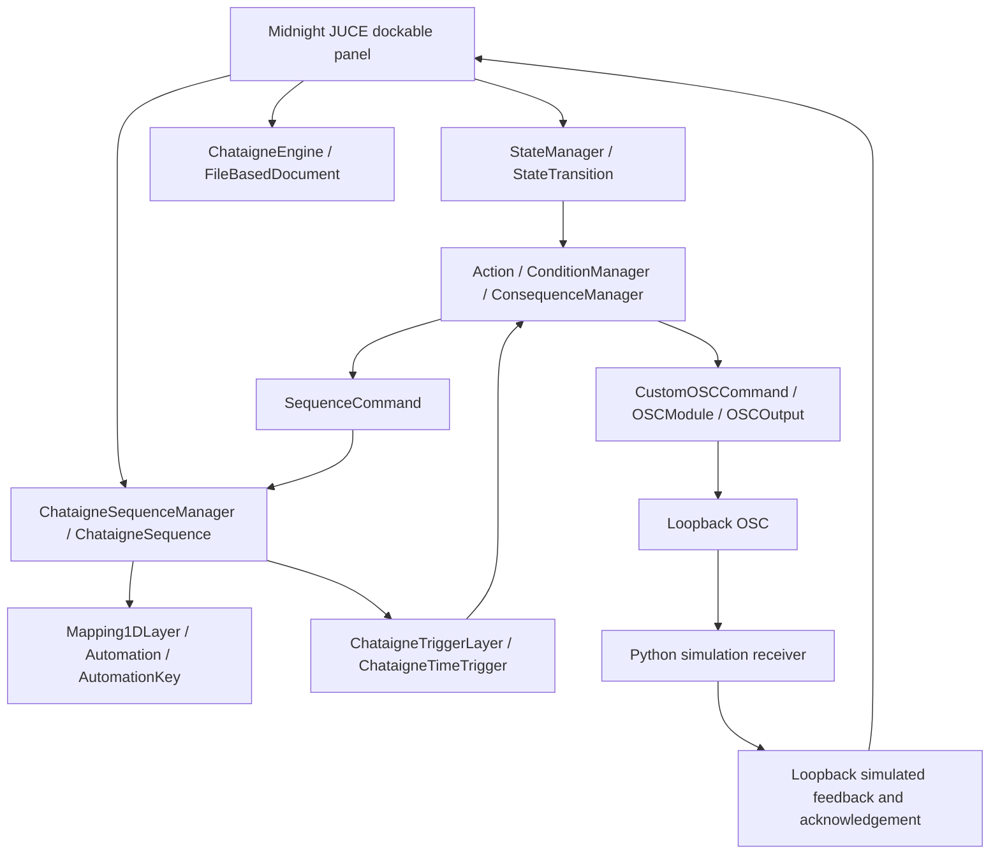

# Midnight Native / Chataigne architecture report

Investigation date: 2 November 2026 (Europe/Brussels).

**Result: the existing native prototype now builds and passes native integration acceptance.**
The Windows executable, native state/sequence execution, OSC receiver, and save/reload across
separate processes are verified. See [the current test report](MIDNIGHT_NATIVE_TEST_REPORT.md)
for evidence and the scope of remaining limitations.

## Isolation and provenance

Independent checkout: `Chataigne_Native_Midnight_POC`, beside the existing V2 worktree.
Branch: `experiment/midnight-native-ui`. Nothing was pushed upstream.

Official Chataigne source: [benkuper/Chataigne](https://github.com/benkuper/Chataigne).
Base revision: `359701090e332c0a0c5dfde4b17de3c2be499524`, version `1.10.5b6`.
The checkout is shallow and includes all six required submodules and nested Asio at their
recorded revisions. Full dependency identities are in [dependencies.json](Midnight/dependencies.json).

V2 remains at `7eb07769f6a1f199526c2324f4c9108d99d2ed7b`, with a clean working tree.
No V2 source, reference controller, project, branch or Git setting was changed.
No CAN/serial library is imported by the simulator. No COM port or physical motor was opened.
The existing installed Chataigne application and its user projects were not launched or changed.

## Actual engine architecture

The native acceptance test exercises these paths using production application objects.
The panel has a 10 Hz display-refresh timer. It does not schedule cues, advance timelines,
choose transitions, or interpolate motor commands. Sequence playback belongs to Chataigne;
the receiver only simulates motion toward already received position/speed targets.

| Responsibility | Existing classes and source |
|---|---|
| Root model and document persistence | `Source/ChataigneEngine.{h,cpp}`; `Modules/juce_organicui/engine/Engine{,FileDocument}.cpp` |
| Application UI composition | `Source/MainComponent.cpp`, `MainContentComponent::init()` |
| Docking and workspace layouts | `Modules/juce_organicui/ui/shapeshifter/ShapeShifter{Factory,Manager,Content}.*` |
| States and exclusivity among connected states | `Source/StateMachine/StateManager.*`, `State/State.*` |
| Transitions and native conditional execution | `Source/StateMachine/Transition/StateTransition.*`; `Source/Common/Processor/Action/Condition/` |
| State entry actions | `Action`, `ActivationCondition`, `ProcessorManager::checkAllActivateActions()` |
| Sequence ownership and playback | `Source/TimeMachine/ChataigneSequenceManager.*`, `Sequence/ChataigneSequence.*`; `Modules/juce_timeline/timeline/Sequence/Sequence.*` |
| Editable curves | `Mapping1DLayer`, `AutomationMappingLayer`; `Modules/juce_organicui/automation/Automation.*`, `AutomationKey.*` |
| Timed conditional events | `Source/TimeMachine/Sequence/layers/trigger/Chataigne{TriggerLayer,TimeTrigger}.*` |
| OSC actions and logging | `Source/Module/modules/common/commands/osc/CustomOSCCommand.*`, `Source/Module/modules/osc/OSCModule.*` |
| Timeline graphics | `TimeMachineView`, `SequenceEditorView`, `SequenceTransportUI`, layer-specific panel/timeline components |
| State graphics | `Source/StateMachine/ui/StateMachineView.*`, `StateViewUI`, `StateTransitionManagerUI` |

`ChataigneEngine` registers managers as controllable containers. Its JSON serializer saves
modules, variable groups, states/transitions and sequences; the loader recreates them using
native factories. Commands serialize their module, command path/type and parameters.
TargetParameters resolve references as the document loads. This is the intended persistence
path for every demo object; no separate Midnight project format was introduced.

UI components already call model APIs and listen to parameters/managers/selection changes.
The `Parameter::AsyncListener`, manager notifications and `Engine::EngineEvent` mechanisms
are the natural production update path. The POC re-resolves named objects during display
refresh and avoids model access while the engine reports loading/clearing. Persistent handles,
rename tracking and full asynchronous lifecycle tests remain production work.

## Native integration written

New module: `Source/Midnight/MidnightPanel.{h,cpp}`.

Only three host source files change:

- `MainComponent.cpp`: include the new implementation once through the existing unity-build
  chain; register one `ShapeShifterDefinition`. All original panels remain registered.
- `Main.cpp`: use a distinct settings identity and layout directory, default experiment analytics
  off, and show the Midnight panel after startup. No automatic demo execution is added.
- `Main.h`: give the experiment a distinct application name, including native instance identity.

The engine, State Machine, Time Machine, OSC implementation and all submodule contents are unchanged.
Settings/layout identity is `MIDNIGHT NATIVE POC`, rather than the installed Chataigne identity.

The panel source provides:

1. New experimental project, native Save/Open, and document-name/dirty-state display.
2. Three native states (`IDLE`, `ARMED`, `RUNNING`) and three `StateTransition` objects.
   Each transition uses a native `StandardCondition` with a Boolean input and equality-to-true
   comparator. Input selection, HIGH/LOW and trigger controls change those actual parameters.
   Native state editing remains available for configuration beyond the demo.
3. On-enter actions: RUNNING executes native Play Sequence and an OSC state notification;
   IDLE executes native Stop Sequence and an OSC simulated motor stop.
4. A six-second `Midnight_Cupboard_Demo`, with a Mapping1DLayer and linear keys
   `(0,0), (1,45), (3,90), (5,0)`. A native mapping writes its evaluated value to the
   `Automation position` parameter.
5. Four timed OSC movement actions at 0, 1, 3 and 5 seconds. Native triggers own their timing.
6. Custom add/update-key and duration controls, Play/Pause/Stop, plus access to the existing
   Chataigne sequence editor. No bespoke timeline widget or playback implementation is added.
7. Direct simulated target/speed fields. Sending uses a native `Consequence` and
   `CustomOSCCommand`, not a second native sender implementation.
8. A loopback JUCE OSC receiver for acknowledgement and simulated position display. Its
   feedback age is visible. It is presentation feedback, not a motor-control loop.

The two examples deliberately separate continuous automation visualization from discrete
position/speed instructions. Editing a curve does not silently stream it to the motor receiver.
Existing timed OSC actions retain their authored motor name/speed when direct-control fields
change; edit their command arguments in the native inspector. These are explicit POC limitations.

## Windows build verification

The resumed development run first compiled untouched application source exported from baseline
`359701090e332c0a0c5dfde4b17de3c2be499524`, then compiled the existing experimental branch.
Visual Studio Build Tools 2026 supplies MSBuild 18.11.1 and the v143 compiler 19.44.35229.
Local generated projects use the installed v145 MSBuild wrappers with `VCToolsVersion=14.44.35207`,
and Windows SDK 10.0.26100.0. The upstream CI dependency strategy and exporters remain unchanged.

Official modified JUCE 7.0.12 is pinned at `d8b1e81eca9bd52a2f0e0783f687f991fa084a7f` in
`C:\Users\Simone\Dev\JUCE`, the external location explicitly approved by the user because D:
has no mounted media. No JUCE repository, submodule, copy, junction or symlink exists in Chataigne.
The other recursive submodules retain their recorded revisions. The exporter's WebView2 SDK
1.0.902.49 is restored from NuGet. All 21 official runtime-pack DLLs loaded successfully.

`Midnight/build.py` generates isolated projects and outputs for baseline and prototype, fixes
the linker output name to match the launcher, stages the official runtime pack, and records
results. The small source compilation fixes qualify `juce::Result` and use a typed point array.
The receiver survives Windows UDP feedback-port unavailability; the panel uses a viewport at
small dock sizes. These changes retain Chataigne's execution and persistence engines.

## MCP investigation

`MCP PLAN.md` is accompanied by actual implementation at this revision:
`Source/MCP/ChataigneMcp.*`, OrganicUI's optional operation registry/server and timeline providers.
Examples include `chataigne_add_transition`, `chataigne_set_command`, project save/open/new,
command discovery and diagnostics. Their handlers call the same native managers and factories.
MCP confirms useful existing adapter patterns at source level; it is not used by this POC,
was not configured or tested, and is not a dependency of the Midnight panel's design.
No assistant account, authentication token, hosted service or MCP transport was added.

## Interface replacement feasibility classes

| Class | Operations | Assessment from source |
|---|---|---|
| A - existing mechanisms | Hide/show/dock panels; preserve native editors; create states, sequences, keys and standard commands; save/load native projects | Public facilities already exist. Runtime acceptance remains pending. |
| B - small adapters | Midnight panel registration, motor-profile editing, Python OSC schema, native GO controls, breadcrumbs and selection synchronization | Suitable extension points; POC adds only panel/identity hooks. |
| C - substantial adaptation | Independent concurrent execution instances of one sequence definition; complete QLab semantics; robust cross-process command ownership/recovery; stable public engine facade | Existing models are not automatically equivalent to Midnight's desired semantics. |
| D - unnecessary reimplementation | Automation interpolation, native timeline graphics, state graph graphics, condition evaluation and basic sequence playback | Reuse these; the POC adds no replacement. |

`TimeMachineView` is itself a ShapeShifterContentComponent and owns a replaceable
`SequenceEditorView`. `MainComponent.cpp` already subclasses it for Chataigne-specific transport.
`StateMachineView` similarly binds to a StateManager. Both can remain docked in a custom workspace;
embedding them as JUCE children is plausible, but custom lifetime/selection/layout behavior has
not been run or verified. Replacing the entire top-level workspace would require more UI wiring,
not necessarily a rewrite of execution logic.

## Maintenance and licensing

Pin the application and all submodule revisions together. Keep Midnight model adaptation in one
module, prefer existing commands/factories, and test object deletion, rename, reload and selection
changes before expanding the interface. Chataigne's UI/engine interfaces are internal C++ APIs,
not a stable plugin ABI. Future updates may change constructors, command definitions, persistence
fields or thread ownership. The small current host diff reduces merge work but cannot guarantee
future compatibility.

Chataigne is GPL-3.0; OrganicUI and juce_timeline declare GPLv3. Distributing a modified application
must respect the applicable source, license and notice requirements. A JUCE commercial license alone
does not remove Chataigne's GPL obligations. Review bundled runtime licenses as part of packaging;
the release DLL archive includes additional notices. The separate Python-process boundary is not,
by itself, a licensing conclusion. See the [upstream license](https://github.com/benkuper/Chataigne/blob/master/LICENSE).

**Recommendation:** retain V2 as the verified motor service. Continue this native experiment only
after a supported build environment is available and the native acceptance procedure passes.
Do not migrate production show control based on this source-level prototype or receiver tests.
